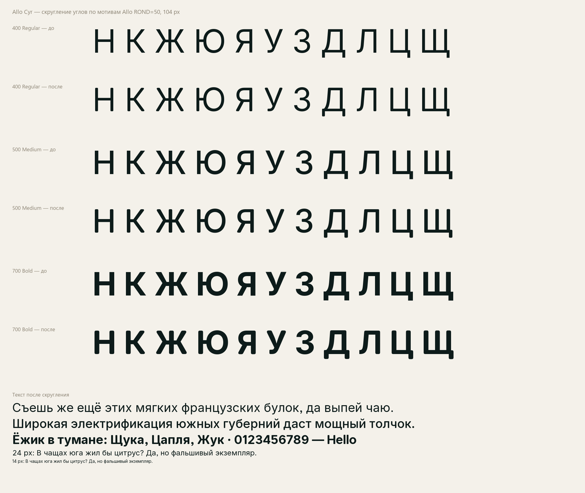

# Allo Cyr

Кириллическая версия [Allo](https://github.com/joshpuckett/allo) — экспериментальная, собранная скриптом.

Латиница — оригинальный Allo 1.0. Кириллица — Inter 4.1, перенесённая в Allo и **со скруглениями в стиле Allo ROND=50**. Три начертания: Regular 400, Medium 500, Bold 700.

| | |
|---|---|
|  | |

## Зачем

У Allo нет кириллицы вообще (467 глифов, только латиница). Но Allo сделан на базе Inter, и у них совпадают все вертикальные метрики:

| | Allo | Inter |
|---|---|---|
| UPM | 2048 | 2048 |
| x-height | 1118 | 1118 |
| cap-height | 1490 | 1490 |
| ascender / descender | 1984 / −494 | 1984 / −494 |

Поэтому кириллицу можно не рисовать: скопировать контуры Inter нужного веса и добавить в `cmap`.

## Как это работает

```
AlloVariable.ttf --instancer(opsz 14, ROND 50, wght 400/500/700)--> статик
Inter-{Regular,Medium,Bold}.ttf --DecomposingRecordingPen--> 248 глифов U+0400–04FF
    -> glyf + hmtx + cmap, имена uni04XX
    -> скругление углов (rounding.py)
    -> name / OS/2 / head: семейство "Allo Cyr", веса 400/500/700
```

### Скругления

ROND в Allo — это не эффект и не фильтр: фаски вшиты в контуры всех 48 мастеров. Геометрия снята замерами (`tools/measure_radius.py`):

| вес | d, units | d / толщина штриха |
|---|---|---|
| 400 | 65.0 | 0.346 |
| 500 | 79.5 | 0.351 |
| 700 | 108.06 | 0.357 |

`d` — расстояние от вершины до точки касания вдоль каждого из двух прямых отрезков. Правила — как в оригинале:

- только **выпуклые** стыки **двух прямых**;
- **счётчики и кривые не трогаются** (`о`, `с`, `е` остаются как есть);
- управляющие точки на `0.2613·d` — это почти круг;
- `d` постоянно в пределах начертания (не зависит от ширины конкретной буквы);
- фаска переводится в квадратики через `cu2qu`, остальные квадратики Inter переносятся без пересчёта.

Из 248 глифов скругляются 230; 18 круглых (`О`, `С`, `о`, `с`, `ё`…) остаются нетронутыми.

## Структура

```
build/
  merge.py             сборка TTF (копирование кириллицы + скругление)
  rounding.py          геометрия фаски Allo ROND=50
  subset.py            woff2-сабсеты
  fetch-sources.ps1    скачать Allo 1.0 + Inter 4.1 в vendor/
build.ps1              полная сборка: TTF -> woff2 -> dist/zip
tools/
  measure_radius.py    замер d по мастерам Allo
  validate.py          сверка со версией без скругления + целостность
  test_roundtrip.py    регресс: контуры не «плывут» при перерисовке
  render_specimens.py  PNG-спексимены в out/png
out/
  ttf/                 готовые TTF (+ plain/ — без скругления)
  web/                 woff2 + test.html (демо, запускать http-сервером)
  png/                 спексимены
dist/AlloCyr-1.0.zip   десктопный пакет (3 TTF + OFL + README)
vendor/                скачанные исходники (в git не попадает)
```

## Сборка

```powershell
.\build.ps1
```

Или по шагам:

```powershell
.\build\fetch-sources.ps1          # один раз, ~40 MB загрузки
python build/merge.py              # TTF со скруглением
python build/merge.py --no-round --out=out/ttf/plain
python build/subset.py             # woff2
python tools/validate.py           # проверки
python tools/render_specimens.py   # PNG
```

Нужен Python 3 с `fonttools>=4.60` и `pillow`; на Windows — `python`, не `python3`.

Демо-страница:

```powershell
cd out\web
python -m http.server 8123
# http://127.0.0.1:8123/test.html
```

## Что важно знать

- Это **статика**. Оси Allo (`wght` 100–900, `ROND` 0–100, `opsz` 9–32) на кириллицу не распространяются: она зафиксирована на `opsz 14 / ROND 50`.
- Промежуточных весов нет: 400 / 500 / 700. Браузер синтезирует 600 сам.
- Кириллица Inter на ~4% светлее латиницы Allo (штрих 180 против 188 в Regular). `d` при этом тот же — у Allo разброс по глифам и то больше.
- Для острых/тупых (не 90°) углов управляющие точки подогнаны линейно по углу: расхождение с точной кривой Allo до ~10%, это ≤0.2 px на 72 px.
- Готовый шрифт — производный от Allo, а не «настоящий Allo»: не стоит выдавать его за официальную кириллицу.

## Лицензия

Оба исходных шрифта — SIL OFL 1.1, Reserved Font Name не объявлен:

- Allo — Copyright 2026 Josh Puckett, https://joshpuckett.me
- Inter — Copyright (c) 2016 The Inter Project Authors, https://github.com/rsms/inter

Производный шрифт распространяется под той же OFL (см. `OFL.txt`). Copyright обоих проектов прописан в `name`-таблице (ID 0). Название «Allo Cyr» не совпадает с Reserved Font Name (его нет), так что переименование не требуется.
